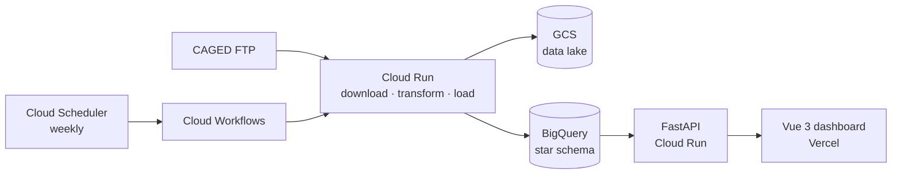

<h1 align="center">Hi, I'm Leonardo 👋</h1>

  <b>Data Engineer & Full-Stack Developer</b> 
  From raw data to dashboards: cloud data pipelines on GCP and modern web apps. 
  📍 Brazil

  
  
  

---

## 🧭 About me

- 📊 **Data Engineer at RIA Catalyst**, a US-based M&A intelligence platform for Registered Investment Advisors, building pipelines with **Python, BigQuery and Google Cloud**.
- 💻 **5+ years of web development** for international teams (USA, Canada and Europe) with **React, Vue and TypeScript**, plus back-end work in Node.js, FastAPI and Supabase.
- 🚀 Co-founder of **[DrenaApp](https://drenaapp.online)** and **HireUp**, two SaaS products in production with paying users.
- 🌎 Fluent in English after 10+ years living and working abroad. I also run Fast English, an online English school, since 2012.

---

## 🛠️ Tech stack

**Data & Cloud**

**Back end**

**Front end**

---

## 🚀 Featured projects

### 📈 CAGED Jobs Dashboard · [Live](https://brazil-jobs-front.vercel.app/)

End-to-end data pipeline over Brazil's official formal employment data (CAGED, Ministry of Labor): about **4.4 million records per month**, modeled as a **BigQuery star schema** and served to an interactive dashboard. Runs fully automated: every week the workflow checks whether a new month was published and loads it, or ends cleanly when there is nothing new. Monthly totals were validated against official government releases.

`Python` `BigQuery` `Cloud Workflows` `Cloud Scheduler` `Cloud Run` `FastAPI` `Vue 3` `Pinia` `ApexCharts`
· Repos: [pipeline & API](https://github.com/leonardovalle34/brazil-jobs) · [front end](https://github.com/leonardovalle34/brazil-jobs-front)

### 🌊 Storm Tracker

Weather and ocean conditions for any point in the world: satellite map, 16-day forecast, hourly wind grid, swell, tide and water temperature, activity recommendations (surf, kite, swimming, diving) and in-app weather alerts, in 5 languages. Own API on Cloud Run with CI/CD through GitHub Actions.

`FastAPI` `Cloud Run` `GitHub Actions` `Vue 3` `TypeScript` `Tailwind` `Leaflet`
· Repos: [back end](https://github.com/leonardovalle34/storm-tracker-backend) · [front end](https://github.com/leonardovalle34/storm-tracker-frontend)

### 💧 DrenaApp · [drenaapp.online](https://drenaapp.online)

SaaS for hydraulic dimensioning of road drainage structures. Three automatic calculation methods (Rational, Corrected Rational, SCS), with results validated against an engineering partner's spreadsheet to under 0.3% error.

`Vue 3` `TypeScript` `Supabase` `Tailwind` `Stripe`

### 🎓 HireUp

English-learning PWA with a 40-lesson track, badges and PDF certificates, a 405-question quiz across 5 levels and a news feed refreshed automatically from 7 sources.

`Vue 3` `TypeScript` `Supabase` `Stripe` `PWA`

---

  <i>More about my work at <a href="https://leonardovalle34.github.io/cv">leonardovalle34.github.io/cv</a></i>

