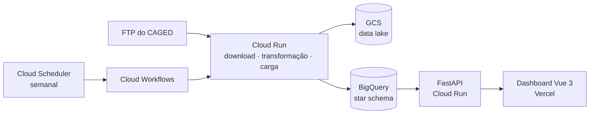

<h1 align="center">Olá, eu sou o Leonardo 👋</h1>

  <b>Engenheiro de Dados & Desenvolvedor Full-Stack</b> 
  Do dado bruto ao dashboard: pipelines de dados na nuvem (GCP) e aplicações web modernas. 
  📍 Brasil

  🇺🇸 <a href="https://github.com/leonardovalle34">English</a> · 🇧🇷 <b>Português</b>

  
  
  

---

## 🧭 Sobre mim

- 📊 **Engenheiro de Dados na RIA Catalyst**, plataforma norte-americana de inteligência de M&A para Registered Investment Advisors, construindo pipelines com **Python, BigQuery e Google Cloud**.
- 💻 **5+ anos de desenvolvimento web** para equipes internacionais (EUA, Canadá e Europa) com **React, Vue e TypeScript**, além de back-end em Node.js, FastAPI e Supabase.
- 🚀 Cofundador do **[HireUp](https://hireup.online)**, um SaaS em produção com usuários pagantes.
- 🌎 Inglês fluente após mais de 10 anos morando e trabalhando no exterior. Também mantenho a Fast English, escola de inglês online, desde 2012.

---

## 🛠️ Tecnologias

**Dados & Cloud**

**Back end**

**Front end**

---

## 🚀 Projetos em destaque

### 📈 CAGED Jobs Dashboard · [Ver online](https://brazil-jobs-front.vercel.app/)

Pipeline de dados de ponta a ponta sobre os dados oficiais de emprego formal do Brasil (CAGED, Ministério do Trabalho): cerca de **4,4 milhões de registros por mês**, modelados em um **star schema no BigQuery** e servidos a um dashboard interativo. Roda de forma totalmente automática: toda semana o workflow verifica se um novo mês foi publicado e o carrega, ou encerra sem erro quando não há nada novo. Os totais mensais foram validados contra as divulgações oficiais do governo.

`Python` `BigQuery` `Cloud Workflows` `Cloud Scheduler` `Cloud Run` `FastAPI` `Vue 3` `Pinia` `ApexCharts`
· Repositórios: [pipeline & API](https://github.com/leonardovalle34/brazil-jobs) · [front-end](https://github.com/leonardovalle34/brazil-jobs-front)

### 🌊 Storm Tracker · [Ver online](https://storm-tracker-view.vercel.app/)

Previsão do tempo e condições do mar para qualquer ponto do mundo: mapa de satélite, previsão de 16 dias, grade de vento hora a hora, swell, maré e temperatura da água, recomendação de atividades (surf, kite, natação, mergulho) e alertas meteorológicos, em 5 idiomas. API própria no Cloud Run com CI/CD via GitHub Actions.

`FastAPI` `Cloud Run` `GitHub Actions` `Vue 3` `TypeScript` `Tailwind` `Leaflet`
· Repositórios: [back-end](https://github.com/leonardovalle34/storm-tracker-backend) · [front-end](https://github.com/leonardovalle34/storm-tracker-frontend)

### 🎓 HireUp · [hireup.online](https://hireup.online)

PWA para aprender inglês com trilha de 40 lições, medalhas e certificados em PDF, quiz com 405 perguntas em 5 níveis e feed de notícias atualizado automaticamente a partir de 7 fontes.

`Vue 3` `TypeScript` `Supabase` `Stripe` `PWA`

---

  <i>Mais sobre o meu trabalho em <a href="https://leonardovalle34.github.io/cv">leonardovalle34.github.io/cv</a></i>

